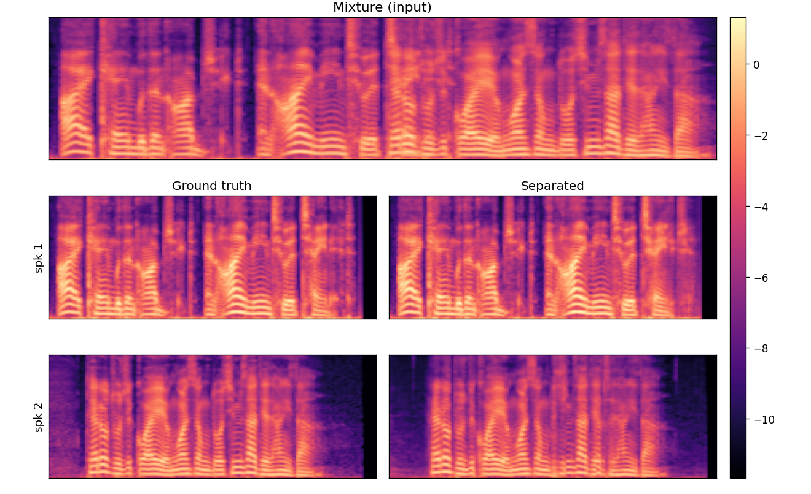
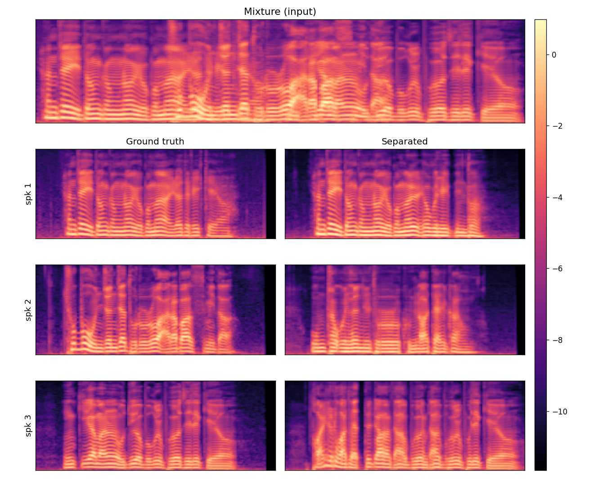
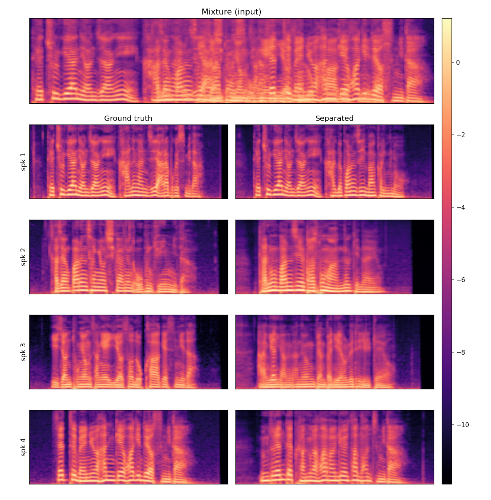

# MouSSe

**Mo**del of **U**ncertainty for **S**peech **Se**paration — a single-stage,
flow-matching speech separator with a per-frame uncertainty (UQ) head and
adaptive UQ-guided classifier-free guidance.

This repository contains the code needed to **train** and **evaluate** the
model reported in the paper.

## Qualitative examples

Each panel shows the input **mixture** (top) and, per source, the
**ground-truth** (left) vs. the model's **separated** mel-spectrogram (right),
across increasing speaker counts and overlap ratios.

| 2 speakers · 25% overlap | 3 speakers · 50% overlap | 4 speakers · 75% overlap |
|:---:|:---:|:---:|
|  |  |  |

## Repository layout

```
MOUSSE/
├── mousse/                     # importable library package
│   ├── configs/
│   │   └── config.py           # audio + model hyper-parameters (single source of truth)
│   ├── models/
│   │   ├── audio_flow.py        # AudioFlow, UncertaintyHead, LearnedSinusoidalPosEmb
│   │   ├── transformer.py       # Transformer backbone, ConvPositionEmbed, ALiBi/RoPE
│   │   └── tensors.py           # RMSNorm, masking helpers, count_parameters
│   └── utils/
│       ├── audio.py             # mel-spectrogram / STFT utilities
│       ├── misc.py              # dict_to_object
│       └── dataset/
│           ├── librittskor.py   # LibriTTS-KOR mixture dataset + collate
│           └── scp/             # test-set manifests (2spk / 3spk / 4spk)
├── training/
│   └── train.py                # single-stage PIT + UQ + entropy-weighted training
├── inference/
│   ├── eval.py                 # evaluation driver (SI-SNRi, SI-SDRi, STOI, PESQ, ...)
│   └── eval.sh                 # reproduces the full evaluation suite from the paper
├── requirements.txt
└── LICENSE
```

All scripts are meant to be **run from the repository root** so that the
top-level `mousse` package is importable.

## Installation

```bash
python -m venv .venv && source .venv/bin/activate
pip install -r requirements.txt
```

Versions in `requirements.txt` are pinned to those used for the paper. The
waveform-domain metrics load an external vocoder at runtime via
`torch.hub.load("ex3ndr/supervoice-vocoder", "bigvsan")`, so network access is
required the first time evaluation runs.

## Data

Training and evaluation read Kaldi-style `.scp` manifests, one line per audio
file. The test-set manifests (1300 mixtures per speaker count) ship in
[mousse/utils/dataset/scp/](mousse/utils/dataset/scp/):

```
scp/<N>spk/
  tt_mix_clean.scp   # mixtures            (tt = test, cv = dev, tr = train)
  tt_s1.scp ...      # per-source targets
```

The paths inside the manifests point to the private LibriTTS-KOR mixture set
(`/shared/NAS_HDD/...`). To reproduce on another machine, regenerate the
mixtures and update the paths in the `.scp` files (or point `scp_base_dir` /
symlink the audio to those locations). Speaker counts of 2, 3 and 4 are
selected via the dataset key `librittskor2` / `librittskor3` / `librittskor4`.

## Configuration

All audio and model hyper-parameters live in
[mousse/configs/config.py](mousse/configs/config.py) and are the single source
of truth for both training and evaluation:

| field | value |
|-------|-------|
| sample_rate | 16000 |
| n_mels / n_fft / hop / win | 100 / 1024 / 256 / 1024 |
| mel_norm / mel_scale | slaney / slaney |
| norm_mean / norm_std | -5.6395 / 5.0133 |
| transformer | 24 layers, 16 heads, dim 1024, ffn 4096 |

Evaluation seeds Python's RNG with `random.seed(42)`.

## Training

```bash
python training/train.py
```

> Note: `training/train.py` pins `CUDA_VISIBLE_DEVICES = "2"` at the top of the
> file (as used for the paper run). Edit that line for your own hardware.
> Runs are logged to Weights & Biases under the project `mousse-stage1`.

## Evaluation

Set the checkpoint path and run the driver from the repository root:

```bash
# edit CKPT="..." near the top of inference/eval.sh, then:
bash inference/eval.sh main       # backbone + adaptive (cap = 1300, paper numbers)
bash inference/eval.sh lambda     # fixed-lambda sweep
bash inference/eval.sh adaptive   # adaptive lambda-scale sweep
bash inference/eval.sh steps      # ODE-steps sweep
bash inference/eval.sh sigma      # STO sigma analysis
bash inference/eval.sh summary    # print summary tables from existing logs
bash inference/eval.sh all        # everything
```

Or call the evaluator directly:

```bash
python inference/eval.py \
    --ckpt /path/to/large-sep-0820.best.pt \
    --stage 1 --gpu 0 --cap 1300 \
    --out results/stage1_uq/backbone_only
```

Key flags: `--stage {1,2}`, `--ablation no_stno`, `--lambda-fixed`,
`--lambda-scale`, `--steps`, `--cap`, `--gpu`, `--out`, `--save-wav`. See the
module docstring in [inference/eval.py](inference/eval.py) for details.
